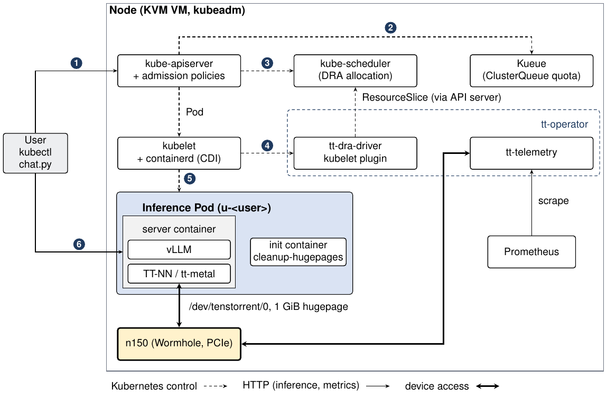
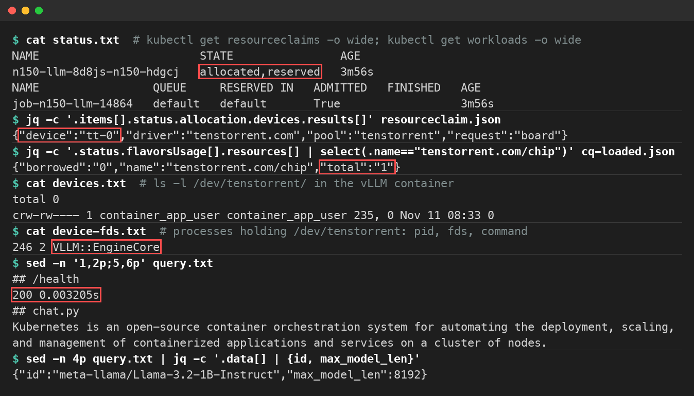
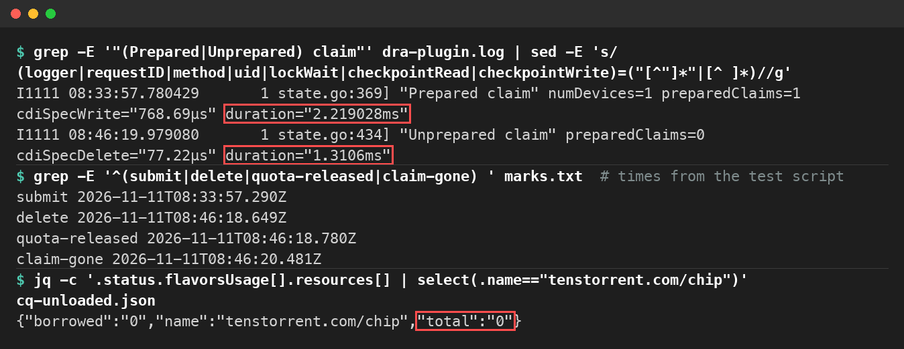
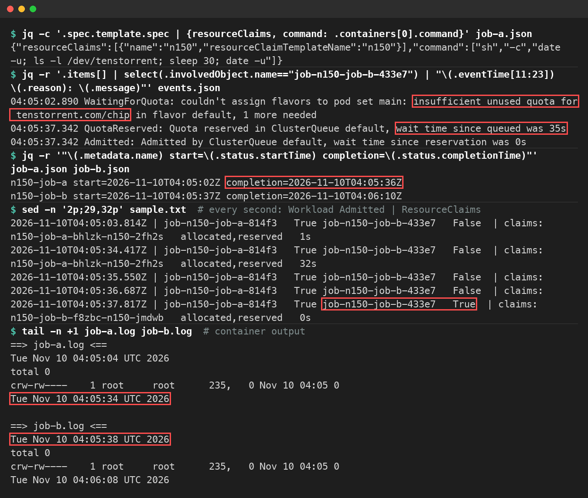
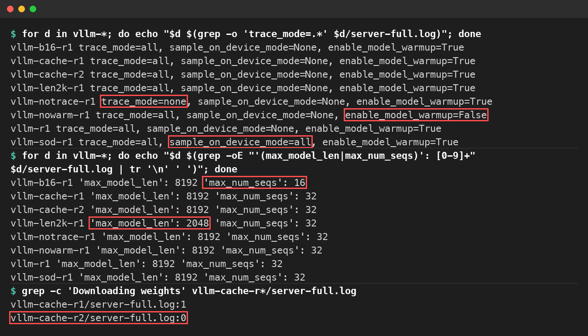
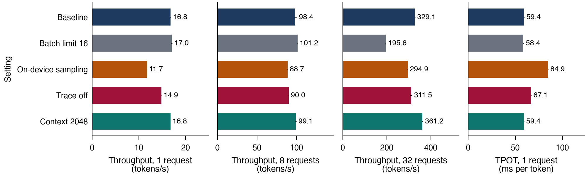

計畫名稱:

AI Container架構、國產晶片平台適配與叢集管理介接研究與驗證

報告名稱:

AI Container模型資源排程與叢集管理介接驗證報告

日期:

2026/11/15

# 中文摘要

本報告將以 Tenstorrent n150 加速卡作為國產 AI 晶片的驗證平台，驗證非 CUDA 晶片於 Kubernetes 的介接方式與 vLLM 推論服務。n150 透過 Dynamic Resource Allocation（DRA）納入叢集，並由 Kueue 管理 quota：每次載入皆只分配一張加速卡，quota 核准與裝置注入於 2 秒內完成；加速卡被占用時，後續 Job 自動排隊，並於前一個 Job 完成後 2 秒內取得加速卡。vLLM 方面，本報告整理出國產晶片須實作的 platform plugin 介面。效能調校結果顯示，batching 使 throughput 達 401.9 tokens/s，保存 model cache 使載入時間由 222.9 秒縮短為 103.9 秒，on-device sampling 與關閉 Metal Trace 則使效能下降。本報告另提供 DRA driver 範本與上線檢核表，供國產晶片導入使用。

**關鍵詞**：國產 AI 晶片、Kubernetes、Dynamic Resource Allocation、Kueue、vLLM、效能調校

# Abstract

This report uses the Tenstorrent n150 as a stand-in for domestic AI chips to verify how a non-CUDA accelerator integrates with Kubernetes and vLLM. The n150 joins the cluster through Dynamic Resource Allocation (DRA) and is queued by Kueue: each load received exactly one card within 2 s, and a queued Job received the card within 2 s after the previous one completed. On the vLLM side, the platform plugin interface a domestic chip must implement is documented. In tuning, batching reached 401.9 tokens/s, a persistent model cache cut load time from 222.9 s to 103.9 s, and on-device sampling and disabling Metal Trace were slower. A DRA driver template and an onboarding checklist are provided.

**Keywords**: domestic AI chip, Kubernetes, Dynamic Resource Allocation, Kueue, vLLM, performance tuning

# 1. 驗證方法（前言）

本報告將以 n150 驗證國產 AI 晶片於 Kubernetes 與 vLLM 的介接方式。n150 與國產晶片同樣不屬於 CUDA 生態系，Kubernetes 與 vLLM 皆未內建支援，兩者比較如表 1。n150 驗證的是介接方式與驗證流程；其 vLLM plugin 與模型程式為 Tenstorrent 專屬，國產晶片須依相同介面自行實作（5.2 節）。

**表 1 國產 AI 晶片與 n150 之比較**

| 面向 | 國產 AI 晶片 | Tenstorrent n150 |
|---|---|---|
| Kernel driver | 自有 driver 與 device node | tt-kmd |
| Kubernetes 支援 | 無內建，須由廠商提供 | 由廠商的 DRA driver 介接 |
| vLLM 支援 | 須自行開發 platform plugin | 由廠商維護的 vLLM fork 提供 |
| 公開程度 | 視廠商而定 | 各層原始碼或發行版本公開 |

使用者於 Job 中以 ResourceClaimTemplate 申請 n150，叢集即自動完成 quota 檢查、裝置分配與注入（第 5 章）。本報告共進行四項實驗，各實驗的驗證內容如表 2；判定標準於實驗前訂定，結果由程式自 Kubernetes objects、DRA driver log、vLLM server log 與 telemetry 重新計算。效能量測皆以 `vllm bench serve` 進行，input 127、output 128 tokens，concurrency 1、8、32 各 3 次。

**表 2 實驗項目與驗證內容**

| 實驗 | 驗證內容 |
|---|---|
| 生命週期 | 模型載入、查詢、推論與卸載是否正常，加速卡與 quota 是否正確分配與歸還 |
| 排隊 | 兩個申請 n150 的 Job 連續送出時，後送出的 Job 是否排隊，並於前一個 Job 完成後取得加速卡 |
| Throughput | batching 對 throughput 與 latency 的影響（`max_num_seqs` 32 與 1） |
| 調校 | 每次調整一項 vLLM 設定，對 throughput、latency 與載入時間的影響（與同日 baseline 比較） |

**表 3 驗證成果之可移轉性**

| 類別 | 項目 |
|---|---|
| 可直接沿用 | Kueue 設定、ResourceClaimTemplate、Job 範例、驗證腳本、vLLM 調校流程 |
| 須由廠商重新實作 | Kernel driver、DRA driver、Prometheus exporter、vLLM platform plugin、container image |
| 須重新量測 | 載入時間、throughput 與 latency、調校參數的效果 |

註：表 3 依 n150 實作歸納，尚未於其他晶片實測。

# 2. 實驗環境

本章列出實驗使用的機器、加速卡與軟體版本，如表 4、表 5 與表 6。

**表 4 機器規格**

| 項目 | 規格 |
|---|---|
| 節點 | KVM VM 1 台，加速卡以 PCIe passthrough 連接至 VM |
| CPU | AMD EPYC 9654，32 vCPU |
| 記憶體 | 62 GiB；1 GiB hugepages 4 頁 |
| OS | Ubuntu 24.04.4 LTS |
| 共用情形 | 多人共用，實驗期間其他使用者的 MI210 服務仍在執行 |

**表 5 加速卡規格（Tenstorrent n150）[1]**

| 項目 | 官方規格 | 本機實測 |
|---|---|---|
| 晶片 | 1 顆 Wormhole，72 個 Tensix core | 辨識為 n150 |
| 記憶體 | 12 GB GDDR6，288 GB/s | 12288 MB |
| 運算效能 | FP8 262 TFLOPS，FP16 74 TFLOPS | - |
| 功耗 | 160 W | 模型載入後 24 W（未於滿載下量測） |
| 介面 | PCIe 4.0 x16 | - |

**表 6 軟體版本**

| 元件 | 版本 |
|---|---|
| Kubernetes | v1.36.5 |
| tt-operator（含 tt-dra-driver、tt-telemetry） | 0.3.0 |
| Kueue | 0.20.1 |
| vLLM（Tenstorrent fork） | 222ee06 |
| tt-inference-server | v0.11.1 |
| 模型 | Llama-3.2-1B-Instruct |

# 3. 操作流程

本章列出使用者部署與使用推論服務的指令及 YAML；YAML 引用的 ResourceClaimTemplate 與 quota 設定見 5.1 節。

## 3.1. 模型載入

```bash
kubectl create secret generic hf-token --from-literal=token=<HF_TOKEN>
kubectl create configmap llm-spec --from-file=spec.json=n150/llama-3.2-1b-n150.json
kubectl replace --force -f n150/llm.yaml
kubectl get pods -w
```

推論 Job（`llm.yaml`）：

```yaml
apiVersion: batch/v1
kind: Job
metadata:
  name: n150-llm
spec:
  template:
    spec:
      restartPolicy: Never
      resourceClaims:
        - {name: n150, resourceClaimTemplateName: n150}   # request one n150
      containers:
        - name: vllm
          image: ghcr.io/tenstorrent/tt-inference-server/vllm-tt-metal-src-release-ubuntu-22.04-amd64:0.11.1-84b4c53-222ee06
          args: ["--tt-device", "n150", "--no-auth"]
          env:
            - name: RUNTIME_MODEL_SPEC_JSON_PATH
              value: /spec/spec.json
            - name: HF_TOKEN
              valueFrom:
                secretKeyRef: {name: hf-token, key: token}
          readinessProbe:
            httpGet: {path: /health, port: 8000}
          volumeMounts:
            - {name: spec, mountPath: /spec}
      volumes:
        - name: spec
          configMap: {name: llm-spec}
```

Model spec 中的 vLLM 參數（`llama-3.2-1b-n150.json` 的 `vllm_args`）：

```json
{
  "model": "meta-llama/Llama-3.2-1B-Instruct",
  "block_size": "64",
  "max_model_len": "8192",
  "max_num_seqs": "32",
  "max_num_batched_tokens": "8192",
  "override_tt_config": "{}"
}
```

## 3.2. 模型卸載

```bash
kubectl delete job n150-llm
```

## 3.3. 推論執行

```bash
kubectl port-forward job/n150-llm 8000:8000 &
python3 chat.py "In one sentence, what is Kubernetes?"
curl -s localhost:8000/v1/chat/completions -H 'Content-Type: application/json' \
  -d '{"model":"meta-llama/Llama-3.2-1B-Instruct","messages":[{"role":"user","content":"What is Kubernetes?"}],"max_tokens":64}'
```

## 3.4. 狀態查詢

```bash
kubectl get workloads                 # quota and queue
kubectl get resourceclaims            # which Pod holds the card
kubectl get resourceslices            # devices published by the DRA driver
curl -s localhost:8000/health         # vLLM is ready
curl -s localhost:8000/metrics | grep -E 'num_requests|kv_cache_usage'
```

# 4. 資源管理與最佳化方法

本章說明推論框架內的資源管理（KV cache 與 batching）與最佳化方法，以及 vLLM 於 n150 的可調參數與調校流程；叢集層級的資源管理見第 5 章，調校結果見 6.3 節。

## 4.1. 推論框架之最佳化方法

常見的推論框架最佳化方法與 n150 的支援情形如表 7。

**表 7 推論框架之最佳化方法**

| 方法 | 說明 | 晶片端須配合 | n150 |
|---|---|---|---|
| PagedAttention [2] | KV cache 以 block 管理 | attention kernel 支援 page table | 支援 |
| Continuous batching [3] | 每一步重新組成 batch | 處理變動的 batch 大小 | 支援 |
| Prefix caching | 重複使用相同 prefix 的 KV cache | 無，由 vLLM 管理 | 支援 |
| Chunked prefill [4] | 長 prompt 分段，與 decode 混合執行 | 同一步混合 prefill 與 decode | 不支援 |
| Speculative decoding [5] | 小模型產生候選 token，大模型驗證 | 一次驗證多個 token | 不支援 |
| Metal Trace [6] | 錄製 kernel dispatch 後重播 | 選用，須固定 input shape | 支援 |
| On-device sampling | 於晶片上完成 sampling | 選用 | 支援，預設關閉 |

## 4.2. 可調參數

n150 的可調參數如表 8，皆寫於 model spec 的 `vllm_args`。前四項為 vLLM 通用參數，後三項為 Tenstorrent 專屬參數（寫在 `override_tt_config`，例如 `"{\"sample_on_device_mode\": \"all\"}"`）。

**表 8 vLLM 於 n150 之可調參數**

| 參數 | 預設 | 影響 |
|---|---|---|
| `max_num_seqs` | 32 | 越大，高 concurrency 時 throughput 越高 |
| `max_model_len` | 8192 | 越小，warmup 越快，但較長的請求會被拒絕 |
| Prefix caching | 開啟 | 共用 system prompt 時可降低 TTFT |
| Model cache（`cache_root`） | 不保存 | 以 hostPath 保存後，免下載與權重轉換 |
| `trace_mode`（TT） | `all` | 關閉 Metal Trace 時每一步較慢 |
| `sample_on_device_mode`（TT） | 關閉 | 開啟後於 n150 上 sampling |
| `enable_model_warmup`（TT） | 開啟 | 關閉可加快啟動，但第一個請求很慢 |

保存 model cache 時，於 Job 加入以下 volume（`llm-cache.yaml`）：

```yaml
volumeMounts:
  - {name: cache, mountPath: /home/container_app_user/cache_root, subPath: cache_root}
volumes:
  - name: cache
    hostPath: {path: /home/testuser/.cache/tt-vllm-cache, type: DirectoryOrCreate}
```

## 4.3. 調校流程

1. 以預設設定建立同日 baseline（不同日期的量測可差 12% 至 18%）。
2. 每次只調整一項設定，並重新載入。
3. 由 server log 確認設定已生效。
4. 以 `vllm bench serve` 量測 throughput、TTFT 與 TPOT（量測條件見第 1 章），並記錄載入時間。

# 5. AI晶片資源之介接方式、資源識別與管理機制

本章說明 AI 晶片如何與 Kubernetes 及 vLLM 介接：5.1 節以 DRA 說明晶片如何被叢集識別、分配並納入 quota，5.2 節說明晶片如何與 vLLM 介接以載入與卸載模型。

## 5.1. DRA 介紹

### 5.1.1. 運作方式

device plugin 只能申請裝置數量 [7]；DRA 於 Kubernetes v1.34 GA [8]，由廠商的 DRA driver 發布每張裝置與其 attributes，使用者以 CEL 條件申請，kube-scheduler 依 attributes 分配 [9]。國產晶片只需提供 DRA driver，即可沿用 Kueue 與使用者的 Job 寫法 [10]。DRA 的主要 objects 如表 9。

**表 9 DRA 之主要 objects**

| Object | 建立者 | 用途 |
|---|---|---|
| ResourceSlice | DRA driver | 發布節點上的裝置與 attributes |
| DeviceClass | 管理者 | 定義一類裝置 |
| ResourceClaim | 由 template 自動產生 | 申請裝置並記錄分配結果 |
| ResourceClaimTemplate | 管理者 | 每個 Pod 自動取得自己的 ResourceClaim |

{width=15cm}

**圖 1 推論 Job 取得 n150 之路徑**

如圖 1 所示，推論 Job 送出後依序經過六個步驟取得 n150：(1) 使用者以 kubectl 送出 Job，admission policy 補上 hugepages、init container 與 device group；(2) Kueue 依 ClusterQueue 的 quota（`tenstorrent.com/chip`）核准 Job；(3) kube-scheduler 依 tt-dra-driver 發布的 ResourceSlice，將裝置 tt-0 分配給 ResourceClaim；(4) kubelet 呼叫 tt-dra-driver 準備裝置並產生 CDI spec；(5) containerd 依 CDI spec 啟動 Pod，將 `/dev/tenstorrent/0` 與 1 GiB hugepage 交給 container；(6) 使用者透過 port-forward 呼叫 vLLM 的 OpenAI-compatible API。圖中虛線為 Kubernetes 的控制流程，細實線為 HTTP（推論 API 與 Prometheus 抓取 metrics），粗線為裝置存取。其中 tt-dra-driver、tt-telemetry 與 TT-NN 為 Tenstorrent 專屬元件，國產晶片導入時須替換為廠商的 DRA driver、exporter 與運算函式庫，其餘元件可直接沿用。

### 5.1.2. 資源識別

晶片由 DRA driver 發布於 ResourceSlice，管理者以 DeviceClass 定義一類裝置，使用者再以 ResourceClaimTemplate 依 attributes 申請。n150 的設定如下。

DeviceClass（由 tt-operator 建立）：

```yaml
apiVersion: resource.k8s.io/v1
kind: DeviceClass
metadata:
  name: tenstorrent.com
spec:
  extendedResourceName: tenstorrent.com/chip
  selectors:
    - cel:
        expression: device.driver == 'tenstorrent.com'
```

ResourceSlice（由 tt-dra-driver 發布，節錄）：

```yaml
apiVersion: resource.k8s.io/v1
kind: ResourceSlice
spec:
  driver: tenstorrent.com
  nodeName: tenstorrent
  pool: {name: tenstorrent, generation: 1, resourceSliceCount: 1}
  devices:
    - name: tt-0
      attributes:
        boardName: {string: n150}
        chipArch: {string: wormhole_b0}
        pciAddress: {string: "0000:02:00.0"}
        vendor: {string: tenstorrent}
      capacity:
        memory: {value: "140725536995392"}   # reported value, not the real 12 GB
```

ResourceClaimTemplate（每個使用者 namespace 一份，`config/user.yaml`）：

```yaml
apiVersion: resource.k8s.io/v1
kind: ResourceClaimTemplate
metadata:
  name: n150
spec:
  spec:
    devices:
      requests:
        - name: board
          exactly:
            deviceClassName: tenstorrent.com
            selectors:
              - cel:
                  expression: device.attributes["tenstorrent.com"].boardName == "n150"
```

### 5.1.3. 管理機制

Kueue 將 DRA 申請計入 quota，加速卡用滿時 Job 自動排隊；admission policy 為申請晶片的 Pod 補上所需設定。

Kueue（`config/kueue-values.yaml` 與 `config/kueue.yaml`，節錄）：

```yaml
# Kueue controller: count DRA requests for this DeviceClass as quota
resources:
  deviceClassMappings:
    - name: tenstorrent.com/chip
      deviceClassNames: [tenstorrent.com]
---
apiVersion: kueue.x-k8s.io/v1beta2
kind: ClusterQueue
metadata:
  name: default
spec:
  queueingStrategy: BestEffortFIFO
  resourceGroups:
    - coveredResources: [cpu, memory, hugepages-1Gi, tenstorrent.com/chip, amd.com/gpu]
      flavors:
        - name: default
          resources:
            - {name: tenstorrent.com/chip, nominalQuota: 1}
            - {name: hugepages-1Gi, nominalQuota: 4Gi}
```

Admission policy（`config/job-defaults.yaml`）為申請 n150 的 Pod 自動加入以下內容（取自實際執行的 Pod）：

```yaml
securityContext:
  supplementalGroups: [2150, 993]        # device groups: tenstorrent, render
initContainers:
  - name: cleanup-hugepages              # remove hugepage files left by a crashed run
    image: busybox:1.37
    command: ["sh", "-c", "rm -f /dev/hugepages-1G/tenstorrent /dev/hugepages-1G/device_0_*tenstorrent"]
containers:
  - name: vllm
    resources:
      requests: {hugepages-1Gi: 1Gi, memory: 8Gi}
      limits: {hugepages-1Gi: 1Gi}
      claims: [{name: n150}]
```

### 5.1.4. 國產晶片之 DRA driver

國產晶片的 DRA driver 須完成以下工作。本報告提供的 DRA driver 範本收錄於管理者 repo（表 17），已通過 `go build` 與 API server dry-run，尚未接上實體晶片 [11][12][13]：

- **發布晶片**：將每顆晶片與 attributes（型號、記憶體、PCI address）發布至 ResourceSlice，容量須正確；driver 重新載入時應更新。n150 僅於啟動時偵測，且記憶體容量回報錯誤。
- **準備與釋放**：Pod 啟動前產生 CDI spec 注入 device node [14]，結束後刪除；兩者須可重複執行。n150 各需 1.2 至 2.4 毫秒。
- **部署**：以 DaemonSet 部署並建立 DeviceClass，再於 Kueue 設定 `deviceClassMappings` 與 quota。

## 5.2. 實作說明（vLLM 介接）

vLLM 以 platform plugin 支援新硬體，晶片廠商只需實作 Platform、Worker 與模型三部分，不必修改 vLLM 原始碼 [15]。以下以 n150 為例說明 [16][17]，vLLM 各層級與提供者如表 10。

**表 10 vLLM 各層級與提供者**

| 層級 | 功能 | 提供者 | n150 |
|---|---|---|---|
| API server | OpenAI-compatible API、tokenizer | vLLM | 直接使用 |
| EngineCore | scheduler、KV cache block 分配 | vLLM | 改用 prefill 優先的 scheduler |
| Platform | 偵測晶片、檢查設定、指定 Worker | 晶片廠商 | TTPlatform |
| Worker | 開啟晶片、載入模型、KV cache、推論、釋放 | 晶片廠商 | TTWorker、TTModelRunner |
| 模型 | 以晶片 operator 實作模型 | 晶片廠商 | TT-NN 實作的 Llama |
| Runtime 與 driver | 晶片 runtime、kernel driver | 晶片廠商 | tt-metal、tt-kmd |

### 5.2.1. Plugin 註冊

plugin 以 entry point `vllm.platform_plugins` 註冊偵測函式；偵測到晶片時回傳 Platform 類別名稱，否則回傳 None。範例（`mychip` 為假設名稱）：

```toml
# pyproject.toml
[project.entry-points."vllm.platform_plugins"]
mychip = "vllm_mychip:register"
```

```python
# vllm_mychip/__init__.py
def register():
    try:
        import mychip_runtime  # vendor runtime, present only on nodes with the chip
    except ImportError:
        return None
    return "vllm_mychip.platform.MyChipPlatform"
```

n150 以能否載入 ttnn 判斷晶片是否存在，但 plugin 寫在 Tenstorrent 的 vLLM fork 中；國產晶片以獨立套件註冊，即可搭配未修改的 vLLM。

### 5.2.2. Platform 類別

- **檢查設定**：啟動時拒絕不支援的功能。n150 不支援 chunked prefill、speculative decoding、tensor/pipeline parallel 與 LoRA。
- **指定 Worker 與 scheduler**：n150 每一步只能執行 prefill 或 decode，故使用 prefill 優先的 scheduler。
- **對應模型與檢查請求**：將模型架構對應到晶片版模型（須註冊於 ModelRegistry），並拒絕不支援的參數。n150 將 `LlamaForCausalLM` 對應為 `TTLlamaForCausalLM`，並拒絕 best_of、prompt_logprobs 與自訂 logits processor。

### 5.2.3. Worker 類別

**表 11 Worker 須實作之方法**

| 方法 | 呼叫時機 | 工作 | n150 |
|---|---|---|---|
| `init_device` | EngineCore 啟動 | 開啟晶片 | 開啟 `/dev/tenstorrent/0`，3 秒 |
| `load_model` | 開啟晶片後 | 建立模型，轉換並載入權重 | 16 層，31 秒 |
| `get_kv_cache_spec` | 載入模型後 | 回報 KV cache 格式 | 依模型設定回報 |
| `determine_available_memory` | 載入模型後 | 回報可用記憶體，供 vLLM 計算 block 數 | 未量測，固定 2080 個 block |
| `initialize_from_config` | block 數決定後 | 於晶片配置 KV cache | 2 秒 |
| `compile_or_warm_up_model` | 配置 KV cache 後 | 編譯常用的 input shape、錄製 trace | 65 秒 |
| `execute_model` | 服務期間每一步 | 執行一批請求，回傳新 token | prefill 或 decode |
| `shutdown` | vLLM 關閉時 | 釋放晶片 | 未實作，於 garbage collection 時關閉 |
| `check_health` | 本版單一 Worker 不呼叫 | 回報晶片狀態 | 一律正常 |

註：表中時間為 n150 第 1 次載入的 server log timestamp。此外，啟動與下載權重 68 秒、平台偵測 20 秒、開始服務 2 秒。

### 5.2.4. 實作重點

- **開啟晶片**：只使用 DRA 注入的晶片，以 device group 取得權限；若需 DMA 記憶體須說明（n150 需 1 GiB hugepage）。
- **載入權重**：權重與 KV cache 須放入晶片記憶體（n150 因此將 context 限制為 8192）；權重轉換結果應保存，n150 保存後由 28 秒縮短為 2 秒。
- **KV cache**：須採用 vLLM 的 block 格式，attention kernel 須支援 page table；block 數宜依剩餘記憶體計算。
- **Warmup**：預先編譯常用的 input shape 並保存結果；n150 關閉 warmup 後，第一個請求需 99.3 秒。
- **推論**：`execute_model` 收到新請求的 prompt token、sampling 參數與 KV block 編號，須執行 prefill 或 decode、完成 sampling 並回傳新 token；只支援固定 shape 的晶片須將 batch padding 至固定大小（n150 為 32）。
- **狀態檢查**：`/health` 只檢查 engine 是否出錯，晶片異常時須於 `execute_model` raise exception；並提供 Prometheus exporter（n150 的記憶體用量為 0）。
- **卸載**：須實作 `shutdown` 釋放資源；process 異常結束時須由 kernel driver 回收晶片（n150 會殘留 hugepage 檔案，需 init container 清除）。

# 6. 驗證結果

本章列出實測結果與結論：6.1 節為執行紀錄，6.2 節為依 log 驗證的功能結果，6.3 節為推論效能與調校結果，6.4 節為結論，6.5 節為限制與後續建議。

## 6.1. 執行紀錄

四項實驗的執行紀錄如表 12。

**表 12 執行紀錄**

| 實驗 | 日期 | 執行內容 | 結果 |
|---|---|---|---|
| 生命週期 | 2026/11/10 | 載入與卸載 3 次 | 全部成功 |
| 排隊 | 2026/11/10 | 兩個 Job 連續送出 | 成功 |
| Throughput | 2026/11/10 | 2 輪，每種條件 3 次 | 全部成功 |
| 調校 | 2026/11/11 | 8 次載入、60 次 benchmark | 全部成功 |

## 6.2. 相關Log驗證結果

各驗證項目的結果如表 13，載入與卸載時間如表 14，各項目的 log 截圖如圖 2 至圖 5。截圖為在實驗保存的 log 檔上執行圖中指令的畫面，指令與輸出皆為原文，紅框為判定依據。

**表 13 驗證項目與結果**

| 項目 | 依據的 log | 結果 | 截圖 |
|---|---|---|---|
| 只分配一張加速卡 | Workload quota 用量、ResourceClaim 分配結果 | 11 次載入皆成立 | 圖 2 |
| 服務可用 | `/health`、`/v1/models`、chat 請求 | 11 次載入皆成立 | 圖 2 |
| DRA 準備與釋放 | tt-dra-driver log | 各 1.2 至 2.4 毫秒 | 圖 3 |
| 推論確實在 n150 上 | EngineCore 開啟的 device node | 成立（throughput 實驗起檢查） | 圖 2 |
| 卸載後釋放 | tt-dra-driver log、ClusterQueue 用量 | 刪除後 2.4 秒內 | 圖 3 |
| 占用時排隊 | Kueue event「insufficient unused quota」 | 前一個 Job 完成後 2 秒內取得 | 圖 4 |
| 調校設定生效 | vLLM server log | 8 次皆成立 | 圖 5 |

**表 14 載入與卸載時間（生命週期實驗，3 次平均）**

| 階段 | 時間（秒） |
|---|---|
| 送出至取得 quota 與加速卡 | 不到 1 |
| Container 啟動 | 1.3 |
| 下載權重 | 67.0 |
| 權重轉換與載入 | 約 30 |
| Warmup（engine init） | 67.4 |
| 送出至 Ready（合計） | 204.6 |
| 刪除至 quota 歸還 | 0.13 |
| 刪除至加速卡釋放 | 2.3 |

Kubernetes 端不到 2 秒，載入時間主要為下載、權重轉換與 warmup。

{width=15cm}

**圖 2 載入完成後的加速卡分配與服務狀態**

圖 2 為調校實驗 baseline 載入完成後保存的狀態，由上而下共七個指令：ResourceClaim 與 Workload 的狀態、ResourceClaim 的分配結果、ClusterQueue 的 `tenstorrent.com/chip` 用量、container 內的 `/dev/tenstorrent`、開啟該 device node 的 process（依序為 PID、開啟數、指令），以及 `/health`、chat 請求與 `/v1/models` 的回應；以 `cat` 顯示的檔案為測試腳本保存的指令輸出，註解為原始指令。由圖 2 可知，ResourceClaim 為 allocated,reserved，分配結果只有裝置 tt-0，quota 用量為 1，container 內只有 `/dev/tenstorrent/0`，且由 vLLM 的 EngineCore process 開啟；`/health` 回傳 200，chat 請求取得回答，`/v1/models` 列出 Llama-3.2-1B-Instruct。

{width=15cm}

**圖 3 tt-dra-driver 準備與釋放加速卡的 log**

圖 3 為同一次載入的 tt-dra-driver log 與卸載紀錄。第一個指令擷取準備（Prepared claim）與釋放（Unprepared claim）兩行，並以 sed 刪除 requestID 等欄位；第二個指令為測試腳本記錄的送出（submit）、刪除（delete）、quota 歸還（quota-released）與 ResourceClaim 消失（claim-gone）時間；第三個指令為卸載後的 ClusterQueue 用量。由圖 3 可知，準備耗時 2.2 毫秒，釋放耗時 1.3 毫秒；Job 刪除後 0.13 秒 quota 歸還，1.8 秒後 ResourceClaim 刪除，`tenstorrent.com/chip` 用量回到 0。

{width=15cm}

**圖 4 加速卡占用時 Kueue 排隊的 log**

圖 4 為排隊實驗的 log。兩個測試 Job（n150-job-a 與 n150-job-b）設定相同，皆以 ResourceClaimTemplate 申請一張 n150，container 列出 `/dev/tenstorrent` 後等待 30 秒；圖中 job-n150-job-a-814f3 與 job-n150-job-b-433e7 為兩者的 Workload。由上而下共五個指令：Job 的 ResourceClaim 與 container 指令、job-b 的 Kueue event、兩個 Job 的開始與完成時間、測試腳本每秒記錄的狀態（每行依序為時間、各 Workload 與其 Admitted 狀態、ResourceClaim 與其狀態），以及兩個 container 的輸出。由圖 4 可知，job-b 送出時因 `tenstorrent.com/chip` quota 不足而等待；job-a 於 04:05:36 完成，job-b 於 04:05:37.34 取得 quota，共排隊 35 秒，04:05:37.82 的紀錄中 job-b 的 ResourceClaim 已分配，即前一個 Job 完成後 2 秒內取得加速卡。兩個 container 使用加速卡的時間為 04:05:04 至 04:05:34 與 04:05:38 至 04:06:08，未重疊。

{width=15cm}

**圖 5 調校設定生效的 vLLM server log**

圖 5 為調校實驗八次載入的 vLLM server log。前兩個指令從各次 log 擷取 TTModelRunner 的設定與啟動參數，第三個指令計算兩次保存 model cache 的載入中下載權重的次數。資料夾名稱與表 16 的對應為：vllm-r1 為 baseline，sod 為 on-device sampling，notrace 為 Metal Trace 關閉，b16 為 `max_num_seqs` 16，len2k 為 `max_model_len` 2048，nowarm 為 warmup 關閉，cache-r1 與 cache-r2 為保存 model cache 的第一次與第二次載入。由圖 5 可知，各次載入只有預定的設定與 baseline 不同（紅框），第二次載入未下載權重，model cache 已生效。

## 6.3. 推論效能與調校結果

batching 的 throughput 如表 15，調校實驗的結果如表 16 與圖 6。

**表 15 Throughput（output tokens/s）**

| Concurrency | `max_num_seqs` 32 | `max_num_seqs` 1 |
|---|---|---|
| 1 | 19.2 | 19.3 |
| 8 | 112.7 | 19.4 |
| 32 | 401.9 | 未測 |

batching 使 concurrency 8 的 throughput 提高為 5.8 倍；`max_num_seqs` 為 1 時，TTFT 拉長至 35 秒。

**表 16 vLLM 調校結果（與同日 baseline 比較）**

| 設定 | Throughput（concurrency 1 / 8 / 32） | TPOT（concurrency 1） | Engine init | 結論 |
|---|---|---|---|---|
| Baseline | 16.8 / 98.4 / 329.1 | 59.4 ms | 68.2 秒 | - |
| On-device sampling | 11.7 / 88.7 / 294.9 | 84.9 ms | 100.5 秒 | 較慢 |
| Metal Trace 關閉 | 14.9 / 90.0 / 311.5 | 67.1 ms | 66.8 秒 | 較慢 |
| `max_num_seqs` 16 | 17.0 / 101.2 / 195.6 | 58.4 ms | 67.0 秒 | concurrency 32 降為 0.59 倍 |
| `max_model_len` 2048 | 16.8 / 99.1 / 361.2 | 59.4 ms | 49.0 秒 | warmup 減少 19 秒 |
| Warmup 關閉 | 未量測 | 未量測 | 2.2 秒 | 第一個請求 99.3 秒 |
| 保存 model cache | 未量測 | 未量測 | 64.2 秒 | 載入 222.9 秒降為 103.9 秒 |

{width=15cm}

**圖 6 各調校設定之 throughput 與 TPOT**

圖 6 由四張子圖組成，前三張為 concurrency 1、8、32 的 output throughput，第四張為 concurrency 1 的 TPOT；每條長條為 3 次量測的平均值，數值標於條尾，誤差線為最小值至最大值，各子圖的橫軸刻度不同。圖中 Batch limit 16 即 `max_num_seqs` 16，Trace off 即關閉 Metal Trace，Context 2048 即 `max_model_len` 2048。

由圖 6 可知，on-device sampling 在各 concurrency 下的 throughput 皆最低，concurrency 1 的 TPOT 由 59.4 ms 增加至 84.9 ms；關閉 Metal Trace 同樣使 throughput 下降，TPOT 增加至 67.1 ms。`max_num_seqs` 16 在 concurrency 1 與 8 時與 baseline 相近，但同時只能處理 16 個請求，concurrency 32 的 throughput 由 329.1 降為 195.6 tokens/s。`max_model_len` 2048 在 concurrency 1 與 8 時與 baseline 相同，concurrency 32 時則較高（361.2 tokens/s）。關閉 warmup 與保存 model cache 只影響載入時間，未列入圖 6（見表 16）。其他結果如下：

- 保存 model cache 效果最大；kernel compile cache 未被保存，原因待查。
- `max_model_len` 2048 時 concurrency 32 的 throughput 高 9.8%，原因未驗證。
- 同日 baseline 較前一日慢 12% 至 18%（原因未查明），故只與同日 baseline 比較。
- 調校實驗事先訂定的七項判定標準中，2 項成立、2 項部分成立、3 項不成立（baseline 重現、on-device sampling、Metal Trace）。

## 6.4. 結論

1. n150 透過 DRA 與 Kueue 可如 GPU 以一般 Job 部署推論服務，分配、排隊與釋放皆自動完成，Kubernetes 端不到 2 秒。
2. 國產晶片須實作 platform plugin 才能與 vLLM 介接（表 11）；n150 的 plugin 無法沿用，但其做法與不足可作為設計參考。
3. vLLM 調校以同日 baseline、一次一項、確認生效進行；保存 model cache 改善最大，平台專屬功能須逐項實測。
4. 國產晶片只需提供 DRA driver 等晶片相關元件，即可沿用本叢集的 quota、排隊與使用方式，並依 7.6 節檢核。

## 6.5. 限制與後續建議

限制：

1. 以 n150 代替國產晶片，效能數值不可直接套用。
2. 單一節點、單張加速卡、單一模型；調校每項設定只載入一次。
3. VM 未啟用 vIOMMU，僅適合信任的使用者。
4. Warmup 約 64 秒，每次載入皆須重做。

後續建議：

1. 將保存 model cache 列為預設，並找出 kernel compile cache 的位置。
2. 於節點空閒時重測調校結果。
3. 為推論 Job 設定預設 timeout，避免加速卡閒置被占用。
4. 取得國產晶片後，依 5.1.4 與 5.2 節實作 DRA driver 與 vLLM plugin，以表 21 檢核，並重新進行本報告的四項實驗。

# 7. 可重複部署之技術文件與開發指引

本章提供重建本環境與導入國產晶片所需的文件：7.1 至 7.4 節為部署與維運，7.5 節為推論服務的設定建議，7.6 節為國產晶片的導入檢核。

## 7.1. 程式封裝

本報告的程式封裝如表 17；實驗原始資料、分析程式與本報告原始檔位於管理者 repo 的 `research` 資料夾。

**表 17 程式封裝**

| 封裝 | 內容 | 位置 |
|---|---|---|
| 管理者 repo | 安裝腳本與設定檔、驗證腳本、DRA driver 範本 | https://github.com/linskybing/k8s-n150-mi210-cluster |
| 使用者 repo | 推論 Job、chat client、自訂 vLLM 範例 | https://github.com/linskybing/k8s-llm-example |
| Helm charts | Kueue、tt-operator、kube-prometheus-stack，版本固定 | 由管理者 repo 的安裝腳本自上游安裝 |
| Container image | Tenstorrent 官方 vLLM image（約 4.1 GB） | ghcr.io/tenstorrent/tt-inference-server |

## 7.2. 安裝流程

```bash
sudo bash scripts/node.sh && sudo reboot    # each node: driver, containerd, kubeadm, hugepages
bash scripts/cluster.sh                     # cluster: Cilium, monitoring, tt-operator, Kueue
sudo bash scripts/add-user.sh alice         # add a user
```

## 7.3. 部署後檢查

部署完成後，依表 18 逐項檢查。

**表 18 部署後檢查**

| 檢查 | 預期結果 |
|---|---|
| `lspci -d 1e52:` | 可見 Wormhole |
| `kubectl get resourceslices` | 一張 n150 |
| `kubectl get clusterqueue,localqueue -A` | 佇列皆存在 |
| Prometheus targets | tt-telemetry 為 up |
| 依第 3 章載入模型 | 約 3.5 分鐘內 Ready |

## 7.4. 疑難排解

常見問題與處理方式如表 19。

**表 19 疑難排解**

| 現象 | 處理方式 |
|---|---|
| Job 持續等待，ResourceSlice 中沒有 n150 | 重新啟動 tt-dra-driver |
| Pod 無法啟動，缺少 Secret | 建立 Hugging Face token Secret |
| 載入時記憶體不足 | 使用 `max_model_len` 8192 的 model spec |
| 異常結束後無法取得 hugepages | 由 init container 自動清除 |
| 調整參數沒有作用 | 確認 ConfigMap 已更新，查看 server log |

## 7.5. 推論服務設定建議

依 6.3 節的調校結果，推論服務的建議設定如表 20。

**表 20 推論服務建議設定**

| 用途 | 建議 |
|---|---|
| 對外服務 | 維持預設並保存 model cache；短對話可將 `max_model_len` 降為 2048 |
| 經常重新部署 | 保存 model cache，載入約 104 秒 |
| 開發測試 | 關閉 warmup 以加快啟動，第一個請求約 100 秒 |

## 7.6. 國產晶片導入檢核

國產晶片依 5.1.4 節完成 DRA driver、依 5.2 節完成 vLLM plugin 後，依表 21 逐項檢核。

**表 21 國產晶片上線檢核表**

| 項目 | 通過條件 |
|---|---|
| 裝置發布 | 每顆晶片出現在 ResourceSlice，attributes 正確 |
| 依 attributes 分配 | 只分配到符合 CEL 條件的晶片 |
| 推論確實在晶片上 | vLLM EngineCore process 開啟晶片的 device node |
| Quota 與排隊 | 晶片用滿時新 Job 等待，釋放後自動取得 |
| 釋放 | 刪除 Job 後 quota 歸還、CDI spec 移除 |
| 重新開機 | 裝置重新發布，可正常載入模型 |
| Monitoring | clock、溫度、功耗、記憶體用量皆有數值 |

# 參考文獻

[1] Tenstorrent Documentation, "Wormhole PCIe Cards." https://docs.tenstorrent.com/aibs/wormhole/

[2] W. Kwon, Z. Li, S. Zhuang, et al., "Efficient Memory Management for Large Language Model Serving with PagedAttention," in Proc. SOSP, 2023. doi:10.1145/3600006.3613165

[3] G.-I. Yu, J. S. Jeong, G.-W. Kim, S. Kim, B.-G. Chun, "Orca: A Distributed Serving System for Transformer-Based Generative Models," in Proc. OSDI, 2022.

[4] A. Agrawal, N. Kedia, A. Panwar, et al., "Taming Throughput-Latency Tradeoff in LLM Inference with Sarathi-Serve," in Proc. OSDI, 2024.

[5] Y. Leviathan, M. Kalman, Y. Matias, "Fast Inference from Transformers via Speculative Decoding," in Proc. ICML, 2023. arXiv:2211.17192

[6] Tenstorrent, "Advanced Performance Optimizations for Models," tt-metal technical report. https://github.com/tenstorrent/tt-metal

[7] Kubernetes Documentation, "Device Plugins." https://kubernetes.io/docs/concepts/extend-kubernetes/compute-storage-net/device-plugins/

[8] Kubernetes Blog, "Kubernetes v1.34: DRA has graduated to GA," 2025. https://kubernetes.io/blog/2025/09/01/kubernetes-v1-34-dra-updates/

[9] Kubernetes Documentation, "Dynamic Resource Allocation." https://kubernetes.io/docs/concepts/resource-management/dynamic-resource-allocation/

[10] Kueue Documentation, "Dynamic Resource Allocation." https://kueue.sigs.k8s.io/docs/concepts/dynamic_resource_allocation/

[11] Kubernetes, "dynamic-resource-allocation" library v0.36.5 (kubeletplugin). https://github.com/kubernetes/dynamic-resource-allocation

[12] Kubernetes SIGs, "dra-example-driver." https://github.com/kubernetes-sigs/dra-example-driver

[13] Kubernetes SIGs, "dra-driver-nvidia-gpu." https://github.com/kubernetes-sigs/dra-driver-nvidia-gpu

[14] CNCF, "Container Device Interface Specification." https://github.com/cncf-tags/container-device-interface

[15] vLLM Documentation, "Plugin System." https://docs.vllm.ai/en/latest/design/plugin_system.html

[16] Tenstorrent, "vLLM fork," commit 222ee06 (vllm/platforms/tt.py, vllm/v1/worker/tt_worker.py, vllm/v1/worker/tt_model_runner.py). https://github.com/tenstorrent/vllm

[17] Tenstorrent, "tt-inference-server," v0.11.1 (vllm-tt-metal/src/run_vllm_api_server.py). https://github.com/tenstorrent/tt-inference-server
